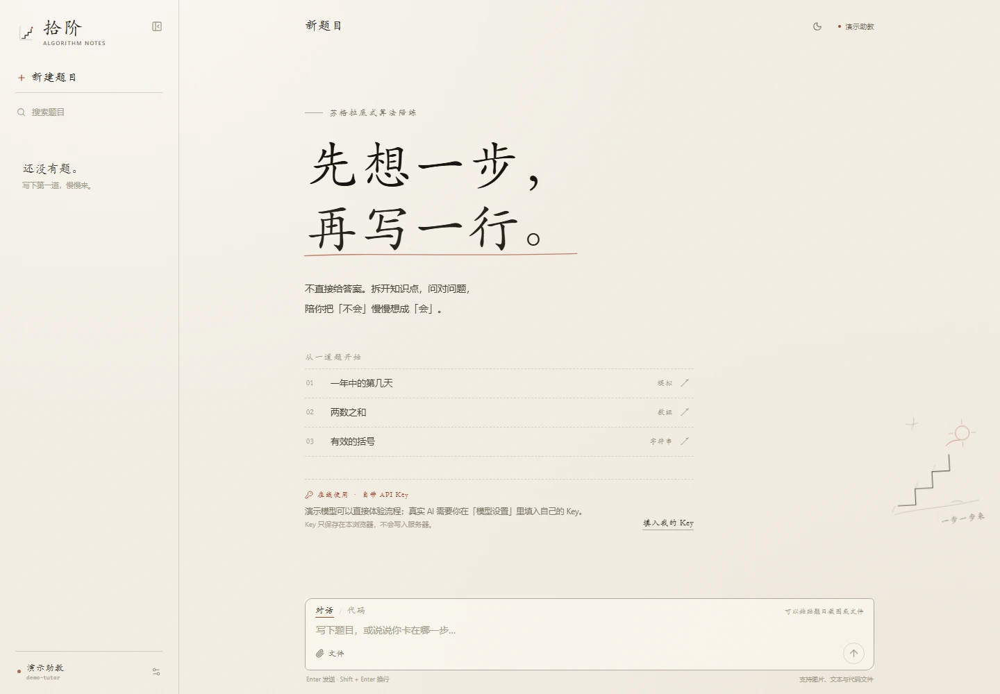
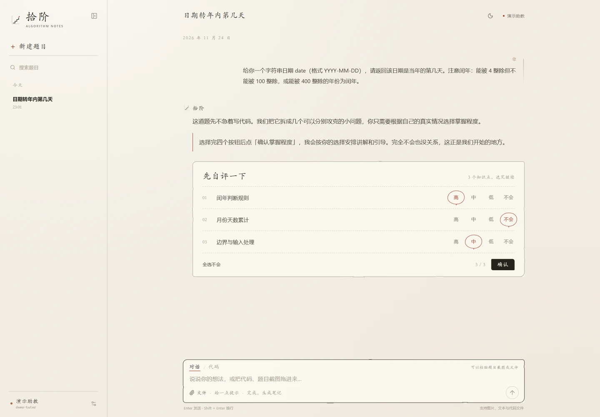
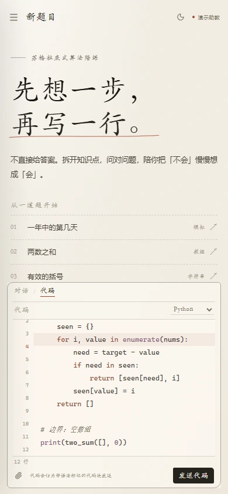

# 拾阶 · 算法题引导助教

> 不直接给答案，陪你把「不会」推成「会」。

拾阶是一个网页版算法题引导助教：学生输入题目后，AI 先拆知识点，让学生用 **高 / 中 / 低 / 不会** 四个按钮确认掌握程度，再按掌握程度分层讲解、逐步提问；学生贴代码时指出问题而不代写；最后说「完成」，生成一份可复制、可下载的复习笔记。左侧是仿 DeepSeek 的会话侧边栏，标题由 AI 自动生成。

界面采用极简手绘风：纸白底色、楷体标题、铅笔红点缀、留白优先，所有框线与标记都由 CSS / SVG 现场绘制，不用一张装饰图片。支持**明暗双主题**、**多文件上传**，以及可在对话与代码编辑器之间切换的输入区；代码编辑器自带语法高亮、行号、当前行高亮、自动缩进和括号/引号配对。



## 功能一览

- **苏格拉底式引导闭环**：拆知识点 → 选择掌握程度 → 分层讲解 → 递进引导 → 代码纠错 → 生成复习笔记。
- **知识点按钮协议**：AI 用 `knowledge` 块输出结构化知识点，前端渲染成卡片；学生只点按钮，不打字。
- **AI 语义标题**：首次回复开头输出 `title` 块，前端自动提取为侧边栏标题；缺失时自动回退到题目前 15 字。
- **仿 DeepSeek 侧边栏**：新建题目、标题搜索（含对话全文）、今天/昨天/更早分组、当前会话高亮、重命名、置顶、删除确认、收起为窄栏、移动端抽屉。
- **对话 / 代码双模式**：输入区可在「对话」与「代码」之间切换。代码模式内置语法高亮、行号、当前行高亮、自动缩进、括号与引号自动配对、匹配括号高亮，写完点「发送代码」即可把代码块发给助教。
- **多文件上传**：支持一次拖入或选择多个图片、文本与代码文件；图片会压缩预览，文本/代码会读取内容，作为多模态上下文一起发送。代码模式也可以附带参考文件。
- **明暗主题**：跟随系统偏好初始化，可一键切换并记住选择；纸感手绘风在深色模式下同样成立。
- **多模型配置**：任意 OpenAI 兼容接口，可新增/编辑/删除多个配置、自由切换、测试连接、温度与流式开关；内置无需 Key 的演示模型。
- **流式输出与停止**：SSE 打字机效果，可中途停止，保留半截内容。
- **复习笔记**：完成时自动生成知识点清单、通法、最终代码、测试用例、易错点与一句话总结；抽屉查看、一键复制 Markdown、下载 `.md`。
- **本地优先**：会话、模型配置、附件与笔记均持久化在浏览器 localStorage，刷新不丢。后端只做无状态转发，不保存对话。
- **极简手绘视觉**：纸感、楷体、铅笔红、手绘框线与阶梯涂鸦；信息层级主要靠留白与字号建立，而不是卡片和颜色。
- **响应式**：桌面双栏 / 窄栏，移动端侧边栏抽屉、全宽聊天、代码编辑器和笔记。

| 知识点自检（手绘圈选） | 代码编辑器 |
| --- | --- |
|  |  |

| 文件上传 | 深色复习笔记 |
| --- | --- |
|  |  |

<p align="center">
  
</p>

## 设计语言

- **纸与墨**：暖纸底色叠加极细颗粒，正文使用易读的系统无衬线，标题与标注使用楷体，像一本摊开的算法笔记。
- **一点铅笔红**：整个界面只保留一个强调色，用于标题下划线、当前会话、已选掌握程度和关键操作。
- **克制的控件**：知识点自评、按钮与设置表单去掉了填充色块和厚边框；选中状态是一圈手绘椭圆，确认按钮是唯一实心黑块。
- **手绘但不凌乱**：`feTurbulence` + `feDisplacementMap` 生成轻微抖动的边框，配合一处阶梯涂鸦；所有装饰都退到内容之后，不抢阅读注意力。
- **昼夜同一套笔触**：深色模式使用暖黑纸、米白墨和更亮的赭石红，不是简单反色；代码块、手绘边框和纸张纹理都单独调过。
- **可访问性**：正文对比度、焦点环、键盘操作（Enter 发送、Shift+Enter 换行、Ctrl/⌘+K 搜索）和移动端触控尺寸都保留。

## 技术栈

| 层 | 选择 | 说明 |
| --- | --- | --- |
| 前端 | React 19 + TypeScript + Vite | 组件化状态管理，无 UI 框架依赖 |
| 样式 | 手写 CSS 设计系统 | 纸白/墨黑/铅笔红双主题 token、手绘描边、响应式布局与克制动效；未使用 Tailwind 以保持零额外构建依赖 |
| Markdown | react-markdown + remark-gfm + rehype-highlight | GFM 表格/任务列表、代码高亮、一键复制 |
| 代码编辑器 | 自研 overlay editor + highlight.js core | 透明 textarea 叠在高亮代码层上；无 CodeMirror/Monaco 等额外大依赖，支持 7 种语言 |
| 图标 | lucide-react | 统一线性图标 |
| 后端 | Node.js 原生 `node:http` | 隐藏 Key、处理 CORS/SSE 流式转发、兼容多模态消息；无需 Express/Fastify |
| 存储 | localStorage | 单浏览器持久化，无服务器数据库 |

> 选择原生 Node HTTP 与手写 CSS 是为了让项目在目标环境里**少依赖、可直接运行**；所有交互协议与业务能力不受影响。

## 快速开始

环境要求：Node.js **20.19+**（推荐 22/24）。

```bash
cd algo-tutor
npm install
npm run dev
```

- 前端：<http://127.0.0.1:5173>
- 后端代理：<http://127.0.0.1:8787>（Vite 已配置 `/api` 代理）
- `npm run dev` 会同时启动 Vite 和 API 服务。

### 先用演示模型体验（无需 API Key）

首次打开项目会带一个「演示助教」配置，它是完全本地的 Mock 模型，走与真实模型**完全相同的协议**，可以体验整个流程：

1. 点击「新建题目」或选择示例题「一年中的第几天」；
2. 等待 AI 输出 title / knowledge 协议，页面显示知识点卡片；
3. 为 3 个知识点分别选择「高 / 中 / 低 / 不会」，点「确认掌握程度」；
4. 看讲解与引导，贴一段代码，再输入「完成，帮我生成复习笔记」；
5. 笔记抽屉自动打开，可复制或下载 Markdown。

### 接入真实模型

点击右上角模型胶囊或左侧底部的配置卡，进入「模型设置」：

1. 点「新增」创建配置，或选择「快速填充」里的服务商预设；
2. 填写 **配置名称、模型名称、API Base URL、API Key**；
3. 点「测试连接」确认可用；
4. 「保存设置」后，顶栏会显示当前模型。

常见配置：

| 服务 | API Base URL | 模型名称示例 |
| --- | --- | --- |
| DeepSeek | `https://api.deepseek.com` | `deepseek-chat` |
| Kimi / 月之暗面 | `https://api.moonshot.cn/v1` | `moonshot-v1-8k` |
| OpenAI | `https://api.openai.com/v1` | `gpt-4o-mini` |
| 通义千问 | `https://dashscope.aliyuncs.com/compatible-mode/v1` | `qwen-plus` |
| Ollama（本地） | `http://127.0.0.1:11434/v1` | `qwen2.5` |

Base URL 既可以填基础地址，也可以直接填完整的 `/chat/completions` 地址。后端会自动补齐 `/v1/chat/completions`。

### 更安全的 Key 方案（可选）

不想把 Key 放进浏览器 localStorage 时，可以把 Key 放到服务端：

```bash
cp .env.example .env
# 编辑 .env，填写：
# AI_API_KEY=sk-xxxx
```

然后在模型设置里把 **API Key 留空** 保存即可。前端请求只会发给本地代理，代理再用 `Authorization: Bearer <key>` 调上游。服务端不会把 Key 写入日志。

> ⚠️ 共用电脑时建议使用服务端 `.env` 方案。保存在 localStorage 的 Key 会被同浏览器的其他脚本读取，页面中已给出安全提示。

## 完整业务流程

1. **新建题目**：用户粘贴题目，发送。新会话在发送时创建，标题先使用题目前 15 字兜底。
2. **拆题**：AI 首次回复开头输出 `title` 块，把题目概括为 ≤15 字中文标题；前端解析后作为会话标题并隐藏原始块。
3. **知识点自检**：AI 用 `knowledge` 块一次性输出 `{"points":[...]}`；前端渲染成卡片，每项有「高 / 中 / 低 / 不会」四个互斥按钮，支持「全选不会」，全部选完才能提交。
4. **提交掌握度**：前端自动拼出 `{"results":[...]}` 作为 user 消息发送，并把已选结果持久化到会话。
5. **分层引导**：AI 对「不会 / 低」先讲概念、为什么需要、最小例子、常见误区，再回到题目；「高 / 中」简要带过。每轮只推进一小步。
6. **代码纠错**：用户贴代码后，AI 指示具体行/变量、说明原因、给反例或要求追踪变量，不直接贴完整修正版。也可以直接切到「代码」模式，在带高亮的编辑器里写完点「发送代码」，或先上传题目截图 / 代码文件再聊。
7. **完成笔记**：用户输入包含「完成 / 做完了 / 写完了 / 帮我生成复习笔记」时，AI 输出完整复习笔记；前端自动保存为 session.note，抽屉展示，并支持复制/下载。
8. **会话管理**：标题自动生成；支持搜索、重命名、置顶、删除、切换。刷新后完整恢复对话、掌握程度、附件和笔记。

对应验收标准全部覆盖；演示模型可离线走通第 1–7 步，并支持文件上传与代码编辑器的完整体验。

## 明暗主题

- 首次打开跟随系统 `prefers-color-scheme`；右上角太阳 / 月亮按钮可随时切换，选择会写入 localStorage。
- 主题不是简单反色：深色模式使用暖黑纸（`#171510`）、米白墨（`#eee6d6`）与提亮的赭石红，纸张颗粒、手绘边框、知识点圈选、代码高亮和设置面板均有独立配色。
- 主题 token 集中在 `src/styles.css` 的 `:root[data-theme="dark"]`；首屏加载前由 `index.html` 内联脚本恢复主题，避免闪烁。
- 通过 `index.html` 内联设置 + React `useEffect` 双层保证首屏与运行时一致；存储键：`shijie-algo-tutor:theme`。

## 代码编辑器

输入区顶部可在「对话」与「代码」模式之间切换。代码模式是自研的轻量 overlay editor（透明 textarea + highlight.js 高亮层），不依赖 CodeMirror / Monaco：

| 能力 | 实现 |
| --- | --- |
| 语法高亮 | highlight.js core，注册 Python / JavaScript / TypeScript / C++ / Java / C / Go |
| 行号 | 独立行号栏，和输入区滚动同步 |
| 当前行高亮 | 按光标位置绘制全宽底色 |
| 自动缩进 | Enter 继承当前缩进；行尾是 `:`、`(`、`[`、`{` 时再缩进一级 |
| 括号 / 引号匹配 | `()`、`[]`、`{}`、`""`、`''`、反引号自动闭合；输入已有右半部分时跳过；退格可成对删除 |
| 匹配括号高亮 | 光标贴近括号时两边同时描红 |
| Tab / Shift+Tab | Tab 插入 2 空格；Shift+Tab 反向缩进；支持多行选区整体缩进 |
| 发送 | 点击「发送代码」把带语言标记的代码块直接发给助教，可随代码附带参考文件 |

发送后自动切回对话模式查看回复；编辑器中的代码与语言选择会保留，可继续修改再发。

## 文件上传

对话与代码模式都支持附件：

- 一次可选择或拖入多个文件（最多 6 个）；也支持直接粘贴剪贴板里的图片。
- **图片**：PNG / JPG / WebP / GIF / BMP / AVIF 等，压缩到最长边 1400px 的 WebP 预览后作为多模态 `image_url` 发送。
- **文本 / 代码**：`.txt`、`.md`、`.py`、`.js`、`.ts`、`.java`、`.cpp`、`.c`、`.go`、`.json`、`.csv`、`.sql` 等几十种文本扩展名；读取内容作为上下文，单个文件最多 512KB / 前 60,000 字符（超出会标注截断）。
- 图片单张最多 10MB；附件会保存在会话里，刷新后仍能看到并继续对话。
- **图片需要模型支持视觉**（例如 GPT-4o 系列）。DeepSeek Chat 等纯文本模型收到图片可能报错，界面会给出提示。
- 暂不支持 PDF / DOCX / XLSX 等二进制文档；可先截图或复制文字后上传。附件内容会发给你配置的模型服务，请注意隐私。
- 服务端 `/api/chat` 兼容 OpenAI 多模态消息格式，请求体上限 25MB。

## 结构化协议（核心实现）

三块协议是产品交互的核心：

### 1. `title` 块（AI → 前端）

````markdown
```title
日期转年内第几天
```
````

- 用于侧边栏命名，长度限制 15 字。
- 前端解析后**隐藏原块**，只显示正文。
- 实现：`src/lib/protocol.ts` 的 `parseAssistantContent()` / `cleanTitle()`。
- 模型漏输出时，前端用题目文本前 15 字兜底，并异步调用 `/api/title` 轻量补全。

### 2. `knowledge` 块（AI → 前端）

````markdown
```knowledge
{"points":[{"id":1,"name":"闰年判断规则"},{"id":2,"name":"月份天数累计"}]}
```
````

- 前端不显示原始 JSON，渲染为知识点卡片。
- 点按钮只改变本地 mastery，不立即请求；全部选好后用户点「确认掌握程度」。
- 实现：`src/lib/protocol.ts` 的 `parseAssistantContent()` / `KnowledgePanel.tsx`。

### 3. `knowledge-result`（前端 → AI）

用户提交后，前端自动构造如下 user 消息：

```json
{"results":[{"id":1,"mastery":"high"},{"id":2,"mastery":"none"}]}
```

`mastery` 取值：`high / medium / low / none`，对应 UI 上的高 / 中 / 低 / 不会。
这条消息在聊天里不会显示成原始 JSON，而是渲染成「已确认知识点掌握程度」的回执卡片。

### 流式解析细节

- 后端把上游 OpenAI SSE 原样转发；前端 `src/lib/api.ts` 逐行解析 `data:`，累积 `delta.content`。
- 正在生成、尚未闭合的 `title` / `knowledge` 块会被临时隐藏（`UNCLOSED_PROTOCOL_RE`），避免 JSON 闪现在气泡里。
- 停止生成时保留已累计文本，并标注「已停止生成」。
- 上游返回 401/402/404/429/网络错误时，映射为中文可操作提示。实现：`server/index.mjs` 的 `friendlyUpstreamError()`。

### 系统提示词

完整助教人格与行为规则在 `src/lib/prompt.ts` 的 `TUTOR_SYSTEM_PROMPT`，包括：

- 绝不直接给出完整答案代码（复习笔记环节除外）；
- title 块只出现一次；
- 按 mastery 决定讲解详略；
- 代码纠错不代写；
- 完成时输出的笔记结构要求。

## 项目结构

```text
algo-tutor/
├─ index.html
├─ package.json
├─ vite.config.ts          # /api 代理到 8787
├─ scripts/dev.mjs         # 开发启动器（API + Vite）
├─ server/
│  ├─ index.mjs            # HTTP API、SSE 代理、标题、连接测试、静态托管
│  └─ mock.mjs             # 内置演示模型的本地剧本（复用真实协议）
├─ src/
│  ├─ App.tsx              # 会话/主题/流式/笔记/设置的总状态编排
│  ├─ types.ts             # Session / Message / Attachment / Theme / ModelConfig
│  ├─ styles.css           # 双主题设计 token、布局、手绘组件、编辑器样式
│  ├─ data/defaults.ts     # 演示模型、服务商预设、示例题
│  ├─ lib/
│  │  ├─ prompt.ts         # 内置 System Prompt
│  │  ├─ protocol.ts       # title / knowledge / knowledge-result 与多模态消息构造
│  │  ├─ api.ts            # SSE 流解析、错误归一化、连接测试
│  │  ├─ code.ts           # 编辑器语法注册、前后括号查找
│  │  ├─ attachments.ts    # 文件识别、图片压缩、文本读取与限额
│  │  ├─ storage.ts        # localStorage 读写、附件与消息校验
│  │  └─ utils.ts          # 时间分组、复制、下载等
│  ├─ hooks/useMediaQuery.ts
│  └─ components/          # 侧边栏、聊天、知识点、CodeEditor、AttachmentList、设置、笔记等
├─ docs/screenshots/       # README 使用的 WebP 截图
├─ .env.example
└─ README.md
```

## 数据结构

```ts
type Mastery = 'high' | 'medium' | 'low' | 'none';
type Theme = 'light' | 'dark';
type AttachmentKind = 'text' | 'image';

interface Attachment {
  id: string;
  name: string;
  mime: string;
  size: number;
  kind: AttachmentKind;
  text?: string;        // 文本 / 代码文件
  dataUrl?: string;     // 压缩后的图片
  width?: number;
  height?: number;
  truncated?: boolean;
}

interface KnowledgePoint { id: number; name: string; mastery?: Mastery }

interface ChatMessage {
  id: string;
  role: 'user' | 'assistant';
  content: string;              // 原始文本，保留协议块以便刷新后重新解析
  kind?: 'text' | 'knowledge' | 'knowledge-result';
  createdAt: number;
  attachments?: Attachment[];   // 随消息发送的文件与图片
  stopped?: boolean;
  error?: string;
}

interface Session {
  id: string;
  title: string;                // AI 生成的 ≤15 字标题
  createdAt: number;
  updatedAt: number;
  messages: ChatMessage[];
  knowledgePoints: KnowledgePoint[];
  knowledgeSubmitted?: boolean;
  note?: Note;
  pinned?: boolean;
}

interface Note {
  id: string;
  title: string;
  markdown: string;
  createdAt: number;
  sourceMessageId?: string;     // 在聊天流里标记「笔记已收录」
}

interface ModelConfig {
  id: string;
  name: string;
  baseUrl: string;
  apiKey: string;
  model: string;
  temperature: number;
  stream: boolean;
}
```

- 会话存储 Key：`shijie-algo-tutor:v1`（一个 JSON，含 sessions/configs/activeConfigId）。
- 主题存储 Key：`shijie-algo-tutor:theme`；侧边栏折叠状态另有独立 key。
- 发送给模型的用户消息在包含图片时会转换成 OpenAI 多模态 `content` 数组：
  `[{ type: 'text', text }, { type: 'image_url', image_url: { url: dataUrl } }]`。
- 写入做了 160ms 防抖，避免流式输出期间频繁写 localStorage。
- 读取时做了字段校验和版本容错；单个浏览器存储上限约 5MB。图片附件使用压缩后的 WebP data URL，数量多或会话很长时仍可能占满空间，建议定期下载笔记并清理会话。

## 脚本

| 命令 | 作用 |
| --- | --- |
| `npm run dev` | 同时启动 API（8787）与 Vite（5173）；修改后端代码后重启一次 |
| `npm run dev:server` | 只启动后端，自动重启（`node --watch`） |
| `npm run dev:web` | 只启动前端 |
| `npm run build` | 构建生产静态资源到 `dist/` |
| `npm start` | 生产模式：后端同时托管 `dist/` 和 API |
| `npm run typecheck` | TypeScript 全量类型检查 |

生产运行：

```bash
npm run build
npm start
# 默认 http://127.0.0.1:8787
```

可通过 `.env` 修改 `PORT` / `HOST`。默认只监听 `127.0.0.1`；如需局域网手机访问，可在 `.env` 设置 `HOST=0.0.0.0`，并自行评估网络暴露风险。

## 常见问题

**页面提示「尚未填写 API Key」**
进入模型设置填写 Key，或按上文使用服务端 `.env` 的 `AI_API_KEY` 并把前端 Key 留空。

**接口地址不存在（404）**
检查 Base URL；也可以直接填写完整的 `/chat/completions` 地址。服务会自动在基础地址后补 `/v1/chat/completions`。

**请求失败 / 余额不足 / Key 无效**
页面会给出中文错误提示，通常是 Key、额度、模型名或网络问题；在设置里点「测试连接」可快速定位。

**刷新后数据还在吗？**
会。会话、知识点选择、附件、笔记、模型配置和主题都保存在 localStorage。更换浏览器/清除站点数据会丢失，请用笔记抽屉的「下载 .md」备份。

**上传支持哪些文件？**
最多 6 个。图片（PNG/JPG/WebP/GIF/BMP/AVIF 等，单张 ≤10MB，压缩后发送）和文本 / 代码文件（≤512KB，超过 60,000 字符会截断）。PDF、DOCX、XLSX 等二进制文档暂不支持，请转换为图片或粘贴文字。

**上传的图片 AI 能看懂吗？**
取决于模型。应用会把图片按 OpenAI 多模态 `image_url` 格式发给模型，GPT-4o 等视觉模型可以读取；DeepSeek Chat、Kimi 等纯文本模型可能无法处理图片。图片输入时输入框上方会提示「图片需要支持视觉的模型」。

**深色模式在哪里切换？**
顶栏右侧的太阳 / 月亮图标。第一次打开默认跟随系统，之后再打开会记住上次选择。聊天、知识点卡片、代码编辑器、笔记抽屉和设置页都有独立深色适配。

**代码编辑器的快捷键？**
`Tab` 缩进、`Shift+Tab` 反缩进、`Enter` 自动缩进、`Ctrl/Cmd+Z` 等原生文本编辑快捷键可用。括号与引号会自动闭合，匹配括号会在光标旁描红；写完点「发送代码」即可交给助教。

**为什么我的 API Key 需要经过本地后端？**
为了绕过浏览器 CORS、统一处理 SSE 流式转发与多模态错误，并让 Key 只在「浏览器 ↔ 本地代理 ↔ 模型服务」之间传递，不直接暴露给第三方脚本。需要更高安全性时请使用服务端 `.env` 方案。

**为什么上传图片后刷新会变慢？**
图片会压缩成 WebP 后随会话保存在 localStorage 中，读取大附件会占用一些时间；建议每个会话只保留必要的截图。生产环境如需长期存储大量附件，建议改为 IndexedDB 或服务端对象存储。

**移动端能用吗？**
可以。通过内置响应式布局，屏幕 ≤900px 时侧边栏变为抽屉，知识点按钮自动换行，代码编辑器、附件区与笔记抽屉全屏可用。若在局域网手机访问，请把 `HOST` 改为 `0.0.0.0` 并以电脑 IP 打开生产端口。

## 开发自检

本项目在 Chromium 1440×1000 与 390×844 下完成了以下验收：

- 演示模型完整走通：拆题 → 知识点按钮 → 掌握度提交 → 讲解 → 贴代码纠错 → 完成 → 笔记抽屉；
- 刷新后会话、知识点选择、笔记、模型配置、主题与图片附件均恢复；
- 侧边栏搜索、重命名、置顶、删除确认、折叠/移动端抽屉正常；
- 模型设置新增/切换/测试连接正常；后端代理的流式、非流式、Base URL 补全、401/402/网络错误映射已用本地 Mock 上游验证；
- 多文件拖拽上传、文本 / 代码与图片混合发送、附件删除、超限拒绝、图片多模态请求转发均已验证；
- 代码编辑器验证了语法高亮、行号滚动同步、当前行高亮、Enter 自动缩进、Tab / Shift+Tab、括号与引号自动闭合、匹配括号高亮及代码直接发送；
- 明暗主题切换、刷新持久化、深色模式下的设置、笔记与移动端编辑器均通过截图检查；
- 停止生成保留半截内容并持久化；
- `npm run typecheck` 与 `npm run build` 通过。

## 说明

- 内置「演示助教」是脚本化 Mock，仅用于无需 Key 的流程体验，回复内容固定，不代表真实模型能力；它可以接收代码与文件占位，但无法真正识别图片内容。
- AI 生成内容可能有误，产品定位是学习陪练而非答案库；请保留自己的判断。
- 文件上传、图片输入和代码编辑内容都会随对话发送给你配置的模型服务；本项目不额外收集或上传数据，会话只存在于本机浏览器。
- 暂不支持 PDF / Word / Excel 的正文抽取；后续可接入相应解析器扩展 `src/lib/attachments.ts`。
- 生产环境部署到公网前，请补充鉴权、速率限制、附件病毒扫描与 HTTPS；当前定位是本地个人学习工具。
