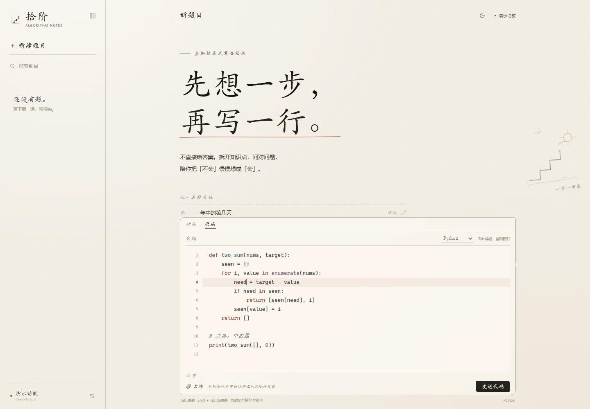
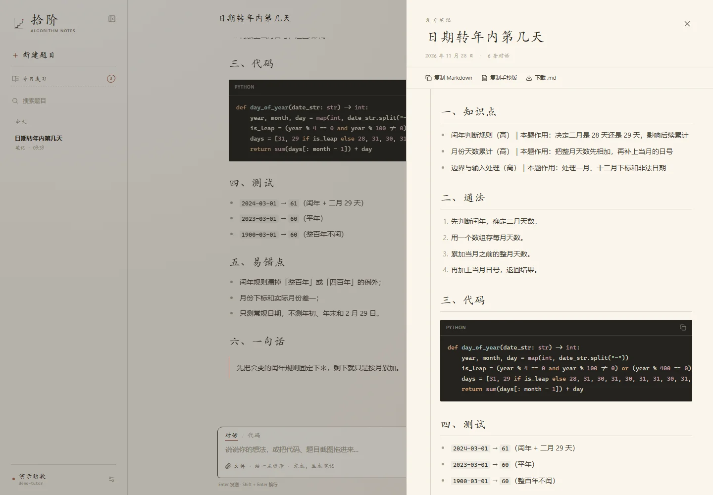

# 拾阶 · 算法题引导助教

> 不直接给答案，陪你把「不会」推成「会」。

拾阶是一个网页版算法题引导助教：学生输入题目后，AI 先拆知识点，让学生用 **高 / 中 / 低 / 不会** 四个按钮确认掌握程度，再按掌握程度分层讲解、逐步提问；学生贴代码时指出问题而不代写；最后说「完成」，生成一份可复制、可下载的复习笔记。左侧是仿 DeepSeek 的会话侧边栏，标题由 AI 自动生成。

界面采用极简手绘风：纸白底色、楷体标题、铅笔红点缀、留白优先，所有框线与标记都由 CSS / SVG 现场绘制，不用一张装饰图片。支持**明暗双主题**、**多文件上传**，以及可在对话与代码编辑器之间切换的输入区；代码编辑器自带语法高亮、行号、当前行高亮、自动缩进和括号/引号配对。


## 功能一览

- **苏格拉底式引导闭环**：拆知识点 → 选择掌握程度 → 分层讲解 → 递进引导 → 代码纠错 → 生成复习笔记。
- **知识点按钮协议**：AI 用 `knowledge` 块输出结构化知识点和「本题作用」，前端渲染成卡片；学生只点按钮，不打字。
- **AI 语义标题**：首次回复开头输出 `title` 块，前端自动提取为侧边栏标题；缺失时自动回退到题目前 15 字。
- **仿 DeepSeek 侧边栏**：新建题目、标题搜索（含对话全文）、今天/昨天/更早分组、当前会话高亮、重命名、置顶、删除确认、收起为窄栏、移动端抽屉。
- **对话 / 代码双模式**：输入区可在「对话」与「代码」之间切换。代码模式内置语法高亮、行号、当前行高亮、自动缩进、括号与引号自动配对、匹配括号高亮，写完点「发送代码」即可把代码块发给助教。
- **多文件上传**：支持一次拖入或选择多个图片、文本与代码文件；图片会压缩预览，文本/代码会读取内容，作为多模态上下文一起发送。代码模式也可以附带参考文件。
- **明暗主题**：跟随系统偏好初始化，可一键切换并记住选择；纸感手绘风在深色模式下同样成立。
- **多模型配置**：任意 OpenAI 兼容接口，可新增/编辑/删除多个配置、自由切换、测试连接、温度与流式开关；内置无需 Key 的演示模型。
- **流式输出与停止**：SSE 打字机效果，可中途停止，保留半截内容。
- **原题速览**：长对话中不用滚回顶部；标题栏右上角的「原题」打开弹层，查看本次会话第一条提问和附件，`Esc` / 点背景即可关闭。
- **复习笔记**：完成时生成「手抄版」提纲——知识点按掌握度分配篇幅（高一行、中加直觉、低加易错），带本题作用、重点/易错标签、3–5 步通法、最终代码、手算验证与最多 3 条测试、易错点、一句话总结；不使用宽表格。抽屉支持复制 Markdown、**复制手抄版纯文本**、下载 `.md`。
- **复习卡与间隔重复**：完成笔记后 AI 自动提炼 1–3 张复习卡；支持「复述规则 / 手推变量 / 默写代码」三种主动回忆模式，按不会 / 模糊 / 会 / 很熟安排下一次复习；默写代码只由 AI 做逻辑审查，不调用编译器。
- **全屏复习工作台**：到期卡片按来源题目分组；可以「混合复习」让不同题目的卡片交替出现，也可以点进某一题只复习该题；复习卡不再挤在弹窗里。
- **本地优先**：会话、模型配置、附件、笔记与复习卡均持久化在浏览器 localStorage，刷新不丢。后端只做无状态转发，不保存对话。
- **公网就绪**：完整 Dockerfile / Render 部署步骤，自带 Key 模式无需共享额度；内置 SSRF 防护、可选上游域名白名单和按 IP 限流。
- **极简手绘视觉**：纸感、楷体、铅笔红、手绘框线与阶梯涂鸦；信息层级主要靠留白与字号建立，而不是卡片和颜色。
- **响应式**：桌面双栏 / 窄栏，移动端侧边栏抽屉、全宽聊天、代码编辑器和笔记。

| 知识点自检（手绘圈选） | 代码编辑器 |
| --- | --- |
|  |  |

| 文件上传 | 手抄版复习笔记 |
| --- | --- |
|  |  |


<p align="center">
  
</p>

## 设计语言

- **纸与墨**：暖纸底色叠加极细颗粒，正文使用易读的系统无衬线，标题与标注使用楷体，像一本摊开的算法笔记。
- **一点铅笔红**：整个界面只保留一个强调色，用于标题下划线、当前会话、已选掌握程度和关键操作。
- **克制的控件**：知识点自评、按钮与设置表单去掉了填充色块和厚边框；选中状态是一圈手绘椭圆，确认按钮是唯一实心黑块。
- **手绘但不凌乱**：`feTurbulence` + `feDisplacementMap` 生成轻微抖动的边框，配合一处阶梯涂鸦；所有装饰都退到内容之后，不抢阅读注意力。
- **昼夜同一套笔触**：深色模式使用暖黑纸、米白墨和更亮的赭石红，不是简单反色；代码块、手绘边框和纸张纹理都单独调过。
- **可访问性**：正文对比度、焦点环、键盘操作（Enter 发送、Shift+Enter 换行、Ctrl/⌘+K 搜索）和移动端触控尺寸都保留。

## 技术栈

| 层 | 选择 | 说明 |
| --- | --- | --- |
| 前端 | React 19 + TypeScript + Vite | 组件化状态管理，无 UI 框架依赖 |
| 样式 | 手写 CSS 设计系统 | 纸白/墨黑/铅笔红双主题 token、手绘描边、响应式布局与克制动效；未使用 Tailwind 以保持零额外构建依赖 |
| Markdown | react-markdown + remark-gfm + rehype-highlight | GFM 表格/任务列表、代码高亮、一键复制 |
| 代码编辑器 | 自研 overlay editor + highlight.js core | 透明 textarea 叠在高亮代码层上；无 CodeMirror/Monaco 等额外大依赖，支持 7 种语言 |
| 图标 | lucide-react | 统一线性图标 |
| 后端 | Node.js 原生 `node:http` | SSE 转发、多模态兼容、静态托管、SSRF 防护与按 IP 限流；无需 Express/Fastify |
| 存储 | localStorage | 单浏览器持久化，无服务器数据库 |

> 选择原生 Node HTTP 与手写 CSS 是为了让项目在目标环境里**少依赖、可直接运行**；所有交互协议与业务能力不受影响。

## 快速开始

环境要求：Node.js **20.19+**（推荐 22/24）。

```bash
cd algo-tutor
npm install
npm run dev
```

- 前端：<http://127.0.0.1:5173>
- 后端代理：<http://127.0.0.1:8787>（Vite 已配置 `/api` 代理）
- `npm run dev` 会同时启动 Vite 和 API 服务。

### 先用演示模型体验（无需 API Key）

首次打开项目会带一个「演示助教」配置，它是完全本地的 Mock 模型，走与真实模型**完全相同的协议**，可以体验整个流程：

1. 点击「新建题目」或选择示例题「一年中的第几天」；
2. 等待 AI 输出 title / knowledge 协议，页面显示知识点卡片；
3. 为 3 个知识点分别选择「高 / 中 / 低 / 不会」，点「确认掌握程度」；
4. 看讲解与引导，贴一段代码，再输入「完成，帮我生成复习笔记」；
5. 笔记抽屉自动打开，可复制 Markdown、复制手抄版纯文本或下载 Markdown。

### 接入真实模型

点击右上角模型胶囊或左侧底部的配置卡，进入「模型设置」：

1. 点「新增」创建配置，或选择「快速填充」里的服务商预设；
2. 填写 **配置名称、模型名称、API Base URL、API Key**；
3. 点「测试连接」确认可用；
4. 「保存设置」后，顶栏会显示当前模型。

常见配置：

| 服务 | API Base URL | 模型名称示例 |
| --- | --- | --- |
| DeepSeek | `https://api.deepseek.com` | `deepseek-chat` |
| Kimi / 月之暗面 | `https://api.moonshot.cn/v1` | `moonshot-v1-8k` |
| OpenAI | `https://api.openai.com/v1` | `gpt-4o-mini` |
| 通义千问 | `https://dashscope.aliyuncs.com/compatible-mode/v1` | `qwen-plus` |
| 智谱 GLM | `https://open.bigmodel.cn/api/paas/v4` | `glm-4-flash-250414` |
| Ollama（本地） | `http://127.0.0.1:11434/v1` | `qwen2.5` |

Base URL 既可以填基础地址，也可以直接填完整的 `/chat/completions` 地址。后端会自动补齐 `/v1/chat/completions`。

> 智谱 GLM 使用 OpenAI 兼容接口，默认模型为免费版 `glm-4-flash-250414`；API Key 可在智谱开放平台的 [API Keys 页面](https://bigmodel.cn/usercenter/proj-mgmt/apikeys) 创建。需要上传图片时，把模型改成 `glm-4v-flash` 等视觉模型。

> 公网部署默认会拦截本机与内网地址，因此 Ollama 这类本地接口需要本地调试时在 `.env` 设置 `ALLOW_PRIVATE_UPSTREAMS=1`。公开部署不要开启这个开关。

### 服务端 Key 方案（可选，仅自用/小范围）

如果你只是自己用，不想把 Key 放进浏览器 localStorage，也可以把 Key 放到服务端：

```bash
cp .env.example .env
# 编辑 .env，填写：
# AI_API_KEY=sk-xxxx
```

然后在模型设置里把 **API Key 留空** 保存即可。前端请求只会发给本地代理，代理再用 `Authorization: Bearer <key>` 调上游。服务端不会把 Key 写入日志。

> ⚠️ 公开给大家使用时不推荐这种方式：所有访客共用你的额度，容易被刷。请优先使用下方的 A 方案（访客自带 Key）。

## 公开部署（A 方案：访客自带 Key）

GitHub Pages 只能托管静态文件，而本项目需要常驻 Node 进程转发 SSE，所以要把整个服务部署到支持 Node 的平台（Render / Railway / Fly.io / 自己的服务器）。推荐先用 Render 免费套餐。

### Render 部署

1. 用 GitHub 登录 [Render](https://render.com/)，选择 **New → Web Service**；
2. 连接本仓库 `wangzihan7335/wangzihan7335.github.io`；
3. 设置：

```text
Root Directory:  algo-tutor
Runtime:         Node
Build Command:   npm install && npm run build
Start Command:   npm start
Health Check:    /api/health
```

4. 环境变量：

| 变量 | 值 | 说明 |
| --- | --- | --- |
| `HOST` | `0.0.0.0` | 必须；否则容器内只监听 127.0.0.1 |
| `NODE_VERSION` | `22` | 项目要求 Node ≥20.19 |
| `TRUST_PROXY` | `1` | Render 反向代理后读取访客真实 IP 限流 |
| `RATE_LIMIT_PER_MINUTE` | `30` | 每 IP 每分钟 API 请求上限 |
| `ALLOWED_API_HOSTS` | 选填 | 允许的模型域名，逗号分隔 |

5. **不要设置 `AI_API_KEY`**。A 方案由每位访客在浏览器里填自己的 Key。
6. 创建服务，等构建完成，得到一个 `https://xxx.onrender.com` 地址；免费实例闲置会休眠，首次访问较慢。

推荐白名单（不设置则允许任意公网 HTTPS 域名）：

```text
ALLOWED_API_HOSTS=api.deepseek.com,api.moonshot.cn,api.openai.com,dashscope.aliyuncs.com,open.bigmodel.cn
```

如果访客需要使用其他中转/自建服务，把对应域名加入这个变量即可。

### 分享给访客时告诉他们

1. 打开站点后，点首页的「填入我的 Key」或右上角模型设置；
2. 选 DeepSeek / Kimi / OpenAI / 通义千问 / 智谱 GLM 预设，或手填其他 OpenAI 兼容接口；
3. 填入自己在服务商后台申请的 API Key，点「测试连接」；
4. 保存后回首页开始；
5. Key 只保存在访客自己的浏览器，不会写入服务器；共用电脑用完请删除模型配置；
6. 需要上传图片时，模型必须支持视觉（如 `gpt-4o-mini`）；DeepSeek Chat 等纯文本模型不能读图。

### 公网安全措施

- 上游地址只允许 `https`，拦截本机、内网、链路本地与保留地址，并禁用重定向，降低 SSRF 风险；
- 可选 `ALLOWED_API_HOSTS` 域名白名单，进一步限定可用服务商；
- 按 IP 限流，`POST /api/chat|title|models/test` 共用每分钟额度；
- 服务端不落库、不打印 API Key，也不会把 Key 写进 URL；Key 仅在请求期间经过内存；
- 图片与文字仍会发送给访客自己配置的模型服务商，公开站点请保留隐私说明。

### Docker 部署

也可以在任何支持容器的平台运行：

```bash
docker build -t shijie-algo-tutor .
docker run -d --name shijie -p 8787:8787 \
  -e ALLOWED_API_HOSTS=api.deepseek.com,api.openai.com,open.bigmodel.cn \
  -e TRUST_PROXY=1 \
  shijie-algo-tutor
```

Dockerfile 已默认设置 `HOST=0.0.0.0`，并暴露 `8787` 端口。生产环境建议放在 HTTPS 反向代理后。

## 完整业务流程

1. **新建题目**：用户粘贴题目，发送。新会话在发送时创建，标题先使用题目前 15 字兜底。
2. **拆题**：AI 首次回复开头输出 `title` 块，把题目概括为 ≤15 字中文标题；前端解析后作为会话标题并隐藏原始块。
3. **知识点自检**：AI 用 `knowledge` 块一次性输出 `{"points":[...]}`；每个知识点包含一个简短的 `role`，说明它在本题中负责什么。前端渲染成卡片，每项有「高 / 中 / 低 / 不会」四个互斥按钮，支持「全选不会」，全部选完才能提交。
4. **提交掌握度**：前端自动拼出 `{"results":[...]}` 作为 user 消息发送，并把已选结果持久化到会话。
5. **分层引导**：AI 对「不会 / 低」先讲概念、为什么需要、最小例子、常见误区，再回到题目；「高 / 中」简要带过。每轮只推进一小步。
6. **代码纠错**：用户贴代码后，AI 指示具体行/变量、说明原因、给反例或要求追踪变量，不直接贴完整修正版。也可以直接切到「代码」模式，在带高亮的编辑器里写完点「发送代码」，或先上传题目截图 / 代码文件再聊。
7. **完成笔记**：用户输入包含「完成 / 做完了 / 写完了 / 帮我生成复习笔记」时，AI 输出一份**手抄版提纲**：六个固定部分；知识点按掌握度展开（高一行、中加直觉、低加易错和正确做法），关键处标「重点 / 易错」；验证区先给具体手算，再列测试；不使用宽表格。前端保存为 session.note，抽屉展示，并支持复制 Markdown、复制纯文本手抄版、下载 `.md`。
8. **生成复习卡**：笔记生成后自动调用复习卡接口，从本次对话提炼 1–3 张「复述 / 推演 / 默写」卡片；也可以从「今日复习」空状态手动生成。
9. **间隔复习**：侧边栏「今日复习」按到期时间排队；用户提交答案，由 AI 批改（默写代码不编译、不运行），选择掌握程度后安排 10 分钟 / 1 天 / 3 天 / 7 天后的复习。
10. **会话管理**：标题自动生成；支持搜索、重命名、置顶、删除、切换。刷新后完整恢复对话、掌握程度、附件、笔记和复习卡。

对应验收标准全部覆盖；演示模型可离线走通第 1–9 步，并支持文件上传与代码编辑器的完整体验。

## 明暗主题

- 首次打开跟随系统 `prefers-color-scheme`；右上角太阳 / 月亮按钮可随时切换，选择会写入 localStorage。
- 主题不是简单反色：深色模式使用暖黑纸（`#171510`）、米白墨（`#eee6d6`）与提亮的赭石红，纸张颗粒、手绘边框、知识点圈选、代码高亮和设置面板均有独立配色。
- 主题 token 集中在 `src/styles.css` 的 `:root[data-theme="dark"]`；首屏加载前由 `index.html` 内联脚本恢复主题，避免闪烁。
- 通过 `index.html` 内联设置 + React `useEffect` 双层保证首屏与运行时一致；存储键：`shijie-algo-tutor:theme`。

## 代码编辑器

输入区顶部可在「对话」与「代码」模式之间切换。代码模式是自研的轻量 overlay editor（透明 textarea + highlight.js 高亮层），不依赖 CodeMirror / Monaco：

| 能力 | 实现 |
| --- | --- |
| 语法高亮 | highlight.js core，注册 Python / JavaScript / TypeScript / C++ / Java / C / Go |
| 行号 | 独立行号栏，和输入区滚动同步 |
| 当前行高亮 | 按光标位置绘制全宽底色 |
| 自动缩进 | Enter 继承当前缩进；行尾是 `:`、`(`、`[`、`{` 时再缩进一级 |
| 括号 / 引号匹配 | `()`、`[]`、`{}`、`""`、`''`、反引号自动闭合；输入已有右半部分时跳过；退格可成对删除 |
| 匹配括号高亮 | 光标贴近括号时两边同时描红 |
| Tab / Shift+Tab | Tab 插入 2 空格；Shift+Tab 反向缩进；支持多行选区整体缩进 |
| 发送 | 点击「发送代码」把带语言标记的代码块直接发给助教，可随代码附带参考文件 |

发送后自动切回对话模式查看回复；编辑器中的代码与语言选择会保留，可继续修改再发。

高亮色板为亮色 / 深色模式分别调校：关键词、字符串、内置函数、类型、注释等使用不同墨色；同时高亮层与透明输入层保持完全相同的字体、字重、内边距和字距，避免输入时光标与文字错位。

## 复习卡（间隔重复）

侧边栏的「今日复习」会显示到期卡片数量。完成一次「复习笔记」后，AI 会自动从这轮学习记录中提炼 1–3 张复习卡；也可以打开「今日复习」，在空状态里手动从当前会话生成。


「今日复习」是一个全屏复习工作台，不再使用小弹窗：

- 首页显示今日到期数、题目数和预计时长；
- **混合复习**：不同题目的卡片轮流出现，避免同一道题连续占满一轮；
- **按题目复习**：每道题显示到期卡数、卡片总数和包含的复习模式，可以只复习这一题；
- 卡片提交、反馈、参考答案和复习评分都在完整页面里展开，代码编辑器有足够空间。

三种主动回忆模式：

| 模式 | 训练什么 | 交互 | 验证方式 |
| --- | --- | --- | --- |
| **复述规则** | 能否用自己的话讲清概念、条件和原因 | 卡片只给问题，用户输入解释 | AI 对照参考答案与评分要点，指出缺失点 |
| **手推变量** | 能否逐轮跟踪程序状态 | 展示一段短代码，用户在输入框写出每轮变量和最终结果 | AI 对照参考推演检查过程 |
| **默写代码** | 能否独立还原实现 | 复用代码编辑器，不看历史答案重写 | **只由 AI 做逻辑审查，不编译、不运行代码、不依赖测试结果** |

每张卡提交后会显示 AI 反馈、缺失要点、参考答案和四档复习评分：

- **不会**：10 分钟后再来；
- **模糊**：1 天后复习；
- **会**：3 天后复习；
- **很熟**：7 天后复习。

复习卡、复习间隔和最近一次批改结果都保存在浏览器 localStorage；删除来源会话时会一并删除该会话的复习卡。演示模型会用启发式规则模拟批改，接入真实模型后由模型完成卡片生成和逻辑审查。

## 文件上传

对话与代码模式都支持附件：

- 一次可选择或拖入多个文件（最多 6 个）；也支持直接粘贴剪贴板里的图片。
- **图片**：PNG / JPG / WebP / GIF / BMP / AVIF 等，压缩到最长边 1400px 的 WebP 预览后作为多模态 `image_url` 发送。
- **文本 / 代码**：`.txt`、`.md`、`.py`、`.js`、`.ts`、`.java`、`.cpp`、`.c`、`.go`、`.json`、`.csv`、`.sql` 等几十种文本扩展名；读取内容作为上下文，单个文件最多 512KB / 前 60,000 字符（超出会标注截断）。
- 图片单张最多 10MB；附件会保存在会话里，刷新后仍能看到并继续对话。
- **图片需要模型支持视觉**（例如 GPT-4o 系列）。DeepSeek Chat 等纯文本模型收到图片可能报错，界面会给出提示。
- 暂不支持 PDF / DOCX / XLSX 等二进制文档；可先截图或复制文字后上传。附件内容会发给你配置的模型服务，请注意隐私。
- 服务端 `/api/chat` 兼容 OpenAI 多模态消息格式，请求体上限 25MB。

## 结构化协议（核心实现）

三块协议是产品交互的核心：

### 1. `title` 块（AI → 前端）

````markdown
```title
日期转年内第几天
```
````

- 用于侧边栏命名，长度限制 15 字。
- 前端解析后**隐藏原块**，只显示正文。
- 实现：`src/lib/protocol.ts` 的 `parseAssistantContent()` / `cleanTitle()`。
- 模型漏输出时，前端用题目文本前 15 字兜底，并异步调用 `/api/title` 轻量补全。

### 2. `knowledge` 块（AI → 前端）

````markdown
```knowledge
{"points":[{"id":1,"name":"闰年判断规则","role":"决定二月是 28 天还是 29 天，影响后续累计"},{"id":2,"name":"月份天数累计","role":"把整月天数先相加，再补上当月的日号"}]}
```
````

- 前端不显示原始 JSON，渲染为知识点卡片。
- 每个知识点下方的「本题作用」来自 `role` 字段；它只解释该知识点在当前题目中的职责，不展开完整解法，帮助用户更准确地自评。
- `role` 为可选字段，最长 60 字；旧会话没有 `role` 时只显示知识点名称，不影响兼容性。
- 点按钮只改变本地 mastery，不立即请求；全部选好后用户点「确认掌握程度」。
- 实现：`src/lib/protocol.ts` 的 `parseAssistantContent()` / `KnowledgePanel.tsx`。

### 3. `knowledge-result`（前端 → AI）

用户提交后，前端自动构造如下 user 消息：

```json
{"results":[{"id":1,"mastery":"high"},{"id":2,"mastery":"none"}]}
```

`mastery` 取值：`high / medium / low / none`，对应 UI 上的高 / 中 / 低 / 不会。
这条消息在聊天里不会显示成原始 JSON，而是渲染成「已确认知识点掌握程度」的回执卡片。

### 流式解析细节

- 后端把上游 OpenAI SSE 原样转发；前端 `src/lib/api.ts` 逐行解析 `data:`，累积 `delta.content`。
- 正在生成、尚未闭合的 `title` / `knowledge` 块会被临时隐藏（`UNCLOSED_PROTOCOL_RE`），避免 JSON 闪现在气泡里。
- 停止生成时保留已累计文本，并标注「已停止生成」。
- 上游返回 401/402/404/429/网络错误时，映射为中文可操作提示。实现：`server/index.mjs` 的 `friendlyUpstreamError()`。

### 系统提示词

完整助教人格、教学阶段与行为规则在 `src/lib/prompt.ts` 的 `TUTOR_SYSTEM_PROMPT`，包括：

- 按「首轮拆题 → 自评回执 → 代码审查 → 卡住升级 → 完成笔记」切换回复策略；
- 普通回合固定为“回应 → 最小推进 → 只问一个问题”，并带 120～250 字预算；
- 提示阶梯（问题 → 概念 → 伪代码 → 更直接提示）逐级推进；
- 不直接给出完整答案代码（用户确认的答案模式与复习笔记除外）；
- title / knowledge 块只出现一次，知识点必须带本题作用；
- 完成时严格按手抄版六段式输出笔记。

## 项目结构

```text
algo-tutor/
├─ index.html
├─ package.json
├─ Dockerfile              # 任意容器平台部署
├─ .node-version           # Render / 平台 Node 版本
├─ vite.config.ts          # /api 代理到 8787
├─ scripts/dev.mjs         # 开发启动器（API + Vite）
├─ server/
│  ├─ index.mjs            # HTTP API、SSE 代理、复习卡生成/批改、静态托管
│  ├─ security.mjs         # SSRF 防护、上游白名单、按 IP 限流
│  └─ mock.mjs             # 内置演示模型的本地剧本（对话/笔记/复习卡）
├─ src/
│  ├─ App.tsx              # 会话/主题/流式/笔记/复习卡/设置的总状态编排
│  ├─ types.ts             # Session / Message / Attachment / ReviewCard / ModelConfig
│  ├─ styles.css           # 双主题设计 token、布局、手绘组件、编辑器与复习卡样式
│  ├─ data/defaults.ts     # 演示模型、服务商预设、示例题
│  ├─ lib/
│  │  ├─ prompt.ts         # 内置 System Prompt
│  │  ├─ protocol.ts       # title / knowledge / knowledge-result 与多模态消息构造
│  │  ├─ api.ts            # SSE 流解析、错误归一化、复习卡 API 客户端
│  │  ├─ review.ts         # 上下文提炼、卡片调度、题目分组与混合队列
│  │  ├─ code.ts           # 编辑器语法注册、前后括号查找
│  │  ├─ attachments.ts    # 文件识别、图片压缩、文本读取与限额
│  │  ├─ storage.ts        # localStorage 读写、复习卡/附件与消息校验
│  │  └─ utils.ts          # 时间分组、复制、下载等
│  ├─ hooks/useMediaQuery.ts
│  └─ components/          # 侧边栏、聊天、知识点、CodeEditor、ReviewWorkspace、设置、笔记等
├─ docs/screenshots/       # README 使用的 WebP 截图
├─ .env.example            # 部署与安全环境变量说明
└─ README.md
```

## 数据结构

```ts
type Mastery = 'high' | 'medium' | 'low' | 'none';
type Theme = 'light' | 'dark';
type AttachmentKind = 'text' | 'image';

interface Attachment {
  id: string;
  name: string;
  mime: string;
  size: number;
  kind: AttachmentKind;
  text?: string;        // 文本 / 代码文件
  dataUrl?: string;     // 压缩后的图片
  width?: number;
  height?: number;
  truncated?: boolean;
}

interface KnowledgePoint { id: number; name: string; mastery?: Mastery }

interface ChatMessage {
  id: string;
  role: 'user' | 'assistant';
  content: string;              // 原始文本，保留协议块以便刷新后重新解析
  kind?: 'text' | 'knowledge' | 'knowledge-result';
  createdAt: number;
  attachments?: Attachment[];   // 随消息发送的文件与图片
  stopped?: boolean;
  error?: string;
}

interface Session {
  id: string;
  title: string;                // AI 生成的 ≤15 字标题
  createdAt: number;
  updatedAt: number;
  messages: ChatMessage[];
  knowledgePoints: KnowledgePoint[];
  knowledgeSubmitted?: boolean;
  note?: Note;
  pinned?: boolean;
}

interface Note {
  id: string;
  title: string;
  markdown: string;
  createdAt: number;
  sourceMessageId?: string;     // 在聊天流里标记「笔记已收录」
}

interface ModelConfig {
  id: string;
  name: string;
  baseUrl: string;
  apiKey: string;
  model: string;
  temperature: number;
  stream: boolean;
}

type ReviewMode = 'explain' | 'trace' | 'code';
type ReviewRating = 'again' | 'hard' | 'good' | 'easy';
type ReviewVerdict = 'correct' | 'partial' | 'incorrect';

interface ReviewCard {
  id: string;
  sessionId: string;
  sessionTitle: string;
  mode: ReviewMode;
  title: string;
  prompt: string;
  reference: string;
  hints?: string[];
  rubric?: string[];
  snippet?: string;              // trace 模式的代码
  language?: string;             // code 模式的语言
  pointName?: string;
  createdAt: number;
  dueAt: number;
  intervalDays: number;
  ease: number;
  reps: number;
  lapses: number;
  lastReviewedAt?: number;
  lastResult?: ReviewRating;
  lastVerdict?: ReviewVerdict;
  lastScore?: number;
  lastFeedback?: string;
  attempts?: number;
}
```

- 会话、配置和复习卡共用存储 Key：`shijie-algo-tutor:v1`（含 sessions/configs/activeConfigId/reviewCards）。
- 主题存储 Key：`shijie-algo-tutor:theme`；侧边栏折叠状态另有独立 key。
- 发送给模型的用户消息在包含图片时会转换成 OpenAI 多模态 `content` 数组：
  `[{ type: 'text', text }, { type: 'image_url', image_url: { url: dataUrl } }]`。
- 写入做了 160ms 防抖，避免流式输出期间频繁写 localStorage。
- 读取时做了字段校验和版本容错；单个浏览器存储上限约 5MB。图片附件使用压缩后的 WebP data URL，数量多或会话很长时仍可能占满空间，建议定期下载笔记并清理会话。

## 脚本

| 命令 | 作用 |
| --- | --- |
| `npm run dev` | 同时启动 API（8787）与 Vite（5173）；修改后端代码后重启一次 |
| `npm run dev:server` | 只启动后端，自动重启（`node --watch`） |
| `npm run dev:web` | 只启动前端 |
| `npm run build` | 构建生产静态资源到 `dist/` |
| `npm start` | 生产模式：后端同时托管 `dist/` 和 API |
| `npm run typecheck` | TypeScript 全量类型检查 |

生产运行：

```bash
npm run build
npm start
# 默认 http://127.0.0.1:8787
```

可通过 `.env` 修改 `PORT` / `HOST`。默认只监听 `127.0.0.1`；如需局域网手机访问，可在 `.env` 设置 `HOST=0.0.0.0`，并自行评估网络暴露风险。

## 常见问题

**页面提示「尚未填写 API Key」**
进入模型设置填写自己的 Key。A 方案（公开部署）下每位访客各自填写；只有自用/小范围部署时才建议使用服务端 `.env` 的 `AI_API_KEY`，并把前端 Key 留空。

**接口地址不存在（404）**
检查 Base URL；也可以直接填写完整的 `/chat/completions` 地址。服务会自动在基础地址后补 `/v1/chat/completions`。

**请求失败 / 余额不足 / Key 无效**
页面会给出中文错误提示，通常是 Key、额度、模型名或网络问题；在设置里点「测试连接」可快速定位。

**刷新后数据还在吗？**
会。会话、知识点选择、附件、笔记、模型配置和主题都保存在 localStorage。更换浏览器/清除站点数据会丢失，请用笔记抽屉的「下载 .md」备份。

**上传支持哪些文件？**
最多 6 个。图片（PNG/JPG/WebP/GIF/BMP/AVIF 等，单张 ≤10MB，压缩后发送）和文本 / 代码文件（≤512KB，超过 60,000 字符会截断）。PDF、DOCX、XLSX 等二进制文档暂不支持，请转换为图片或粘贴文字。

**上传的图片 AI 能看懂吗？**
取决于模型。应用会把图片按 OpenAI 多模态 `image_url` 格式发给模型，GPT-4o 等视觉模型可以读取；DeepSeek Chat、Kimi 等纯文本模型可能无法处理图片。图片输入时输入框上方会提示「图片需要支持视觉的模型」。

**深色模式在哪里切换？**
顶栏右侧的太阳 / 月亮图标。第一次打开默认跟随系统，之后再打开会记住上次选择。聊天、知识点卡片、代码编辑器、笔记抽屉和设置页都有独立深色适配。

**代码编辑器的快捷键？**
`Tab` 缩进、`Shift+Tab` 反缩进、`Enter` 自动缩进、`Ctrl/Cmd+Z` 等原生文本编辑快捷键可用。括号与引号会自动闭合，匹配括号会在光标旁描红；写完点「发送代码」即可交给助教。

**复习卡怎么生成？**
完成一次复习笔记后会自动从对话中提炼 1–3 张；也可以在侧边栏「今日复习」的空状态里，从当前会话手动生成。没有完成笔记的会话同样支持手动生成。

**默写代码会调用编译器或测试用例吗？**
不会。这是本作品刻意选择的设计：代码卡只把用户答案和参考答案交给 AI 做逻辑审查，不编译、不运行代码，也不声称测试通过。它适合训练回忆和实现能力，不等同于在线判题。

**为什么侧边栏有「今日复习」但点进去是空的？**
说明当前没有到期卡片。完成一次学习对话和笔记后会自动生成；如果当前会话还没有卡片，空状态会提供「从当前会话生成复习卡」按钮。

**为什么我的 API Key 需要经过后端代理？**
为了绕过浏览器 CORS、统一处理 SSE 流式转发与多模态错误，并让 Key 只在「浏览器 ↔ 你的服务端 ↔ 模型服务」之间传递。服务端不落库、不打印 Key；公开部署建议每位访客用自己的 Key，并根据服务商后台设置消费上限。若完全不想让 Key 经过任何服务器，需要本地运行本项目的 Node 服务。

**为什么上传图片后刷新会变慢？**
图片会压缩成 WebP 后随会话保存在 localStorage 中，读取大附件会占用一些时间；建议每个会话只保留必要的截图。生产环境如需长期存储大量附件，建议改为 IndexedDB 或服务端对象存储。

**移动端能用吗？**
可以。通过内置响应式布局，屏幕 ≤900px 时侧边栏变为抽屉，知识点按钮自动换行，代码编辑器、附件区与笔记抽屉全屏可用。若在局域网手机访问，请把 `HOST` 改为 `0.0.0.0` 并以电脑 IP 打开生产端口。

## 开发自检

本项目在 Chromium 1440×1000 与 390×844 下完成了以下验收：

- 演示模型完整走通：拆题 → 知识点按钮 → 掌握度提交 → 讲解 → 贴代码纠错 → 完成 → 笔记抽屉；
- 复习卡完整走通：笔记完成后自动生成 3 张卡 → 三种模式依次出现 → AI 批改 → 参考答案 → 评分 → 空状态完成；也验证了从当前会话手动生成；
- 全屏复习工作台验证：到期卡按题目分组、混合复习队列、单题目复习、完成页返回分组和移动端全屏布局；
- 复习卡调度验证：四档评分写入 localStorage，卡片从已到期队列移除；刷新后复习卡与最近批改结果恢复；
- 原题速览验证：长对话中标题栏「原题」始终可见；桌面与 390×844 移动端都能打开原题弹层并显示第一条提问，按 Escape / 点遮罩关闭；
- 知识点卡片验证：桌面端和 390×844 移动端均显示「本题作用」，作用字号提升到 12px / 11.5px，三个知识点无横向溢出；角色文本随会话持久化，刷新后恢复；
- 手抄版笔记验证：新笔记为六段式、按掌握度分配篇幅、无宽表格，含手算验证、重点/易错标签和本题作用；复制手抄版会把 Markdown 标记清理为纯文本并保留代码缩进；
- 刷新后会话、知识点选择、笔记、模型配置、主题与图片附件均恢复；
- 侧边栏搜索、重命名、置顶、删除确认、折叠/移动端抽屉正常；
- 模型设置新增/切换/测试连接正常；后端代理的流式、非流式、Base URL 补全、401/402/网络错误映射已用本地 Mock 上游验证；
- 多文件拖拽上传、文本 / 代码与图片混合发送、附件删除、超限拒绝、图片多模态请求转发均已验证；
- 公网安全：内网 / 本机 / 云元数据地址拦截、https 强制、域名白名单、302 重定向阻断、按 IP 限流均已用本地 Mock 上游验证；
- 首页「在线使用 · 自带 API Key」引导、设置页 Key 提示与服务商预设提示在 Chromium 1440×1000 下通过截图检查；
- 代码编辑器验证了语法高亮（亮/暗两套高对比色板）、行号滚动同步、当前行高亮、Enter 自动缩进、Tab / Shift+Tab、括号与引号自动闭合、匹配括号高亮及代码直接发送；同时修正了高亮层与透明输入层因 Markdown 代码主题 `padding` 泄漏导致的文本/光标错位，并验证了长代码纵向滚动与长行横向滚动同步；
- 明暗主题切换、刷新持久化、深色模式下的设置、笔记与移动端编辑器均通过截图检查；
- 复习卡生成/批改 API 通过演示模型验证；复习抽屉在 1440×1000 与 390×844 下完成布局和操作检查；
- 停止生成保留半截内容并持久化；
- `npm run typecheck` 与 `npm run build` 通过。

## 说明

- 内置「演示助教」是脚本化 Mock，仅用于无需 Key 的流程体验，回复内容固定，不代表真实模型能力；它可以接收代码与文件占位，但无法真正识别图片内容。
- AI 生成内容可能有误，产品定位是学习陪练而非答案库；请保留自己的判断。
- 复习卡里的代码批改只做 AI 逻辑审查，不做编译/测试；不能替代真实在线判题。
- 演示模型的复习卡批改为启发式占位，接入真实模型后才会得到更细的逐点反馈。
- 文件上传、图片输入和代码编辑内容都会随对话发送给你配置的模型服务；本项目不额外收集或上传数据，会话只存在于本机浏览器。
- 暂不支持 PDF / Word / Excel 的正文抽取；后续可接入相应解析器扩展 `src/lib/attachments.ts`。
- 公开部署建议：保持 `ALLOW_PRIVATE_UPSTREAMS=0`、配置 `ALLOWED_API_HOSTS` 与 `RATE_LIMIT_PER_MINUTE`，使用 HTTPS 和平台提供的自动备份/监控；若改为公共 Key 模式，还需要登录、额度和账单上限。
- 生产环境如需长期存储大量附件，建议改为 IndexedDB 或服务端对象存储；当前会话存储在用户自己的浏览器 localStorage 中。
